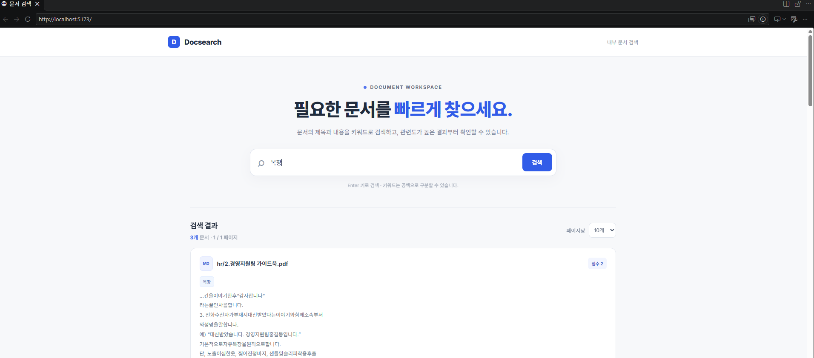
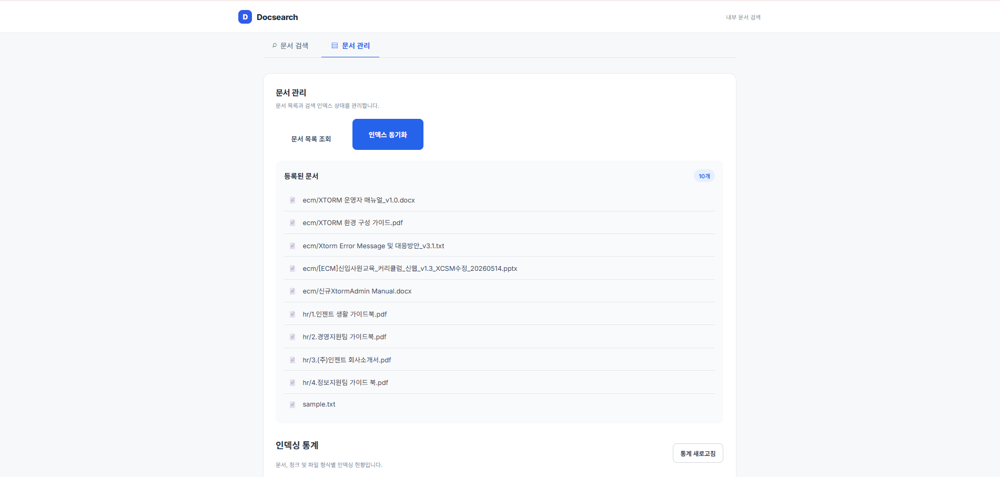
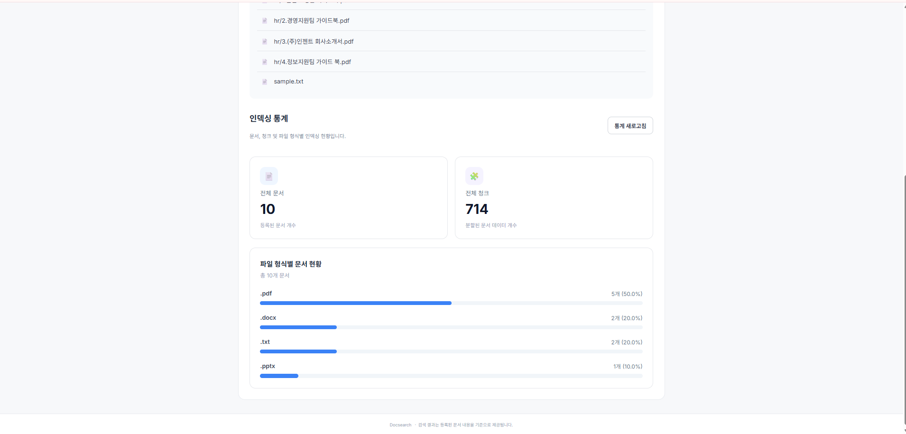
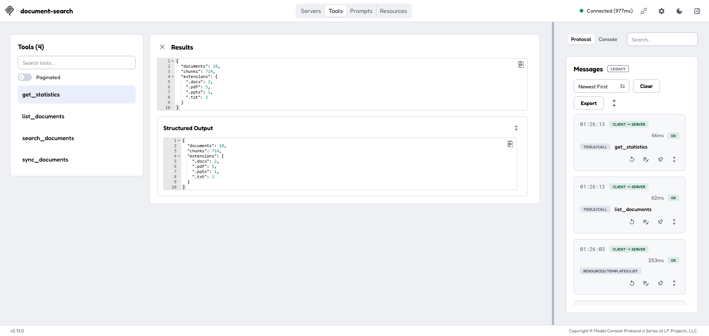

# MCP Document Search

Started 26.10.22
Last Updated 26.11.25

로컬 문서를 탐색하고 검색할 수 있는 문서 검색 서버입니다.

두 가지 방식으로 사용할 수 있습니다.
- **Web UI**: 웹 브라우저에서 문서 목록을 확인하고 검색할 수 있습니다.
- **MCP**: AI 어시스턴트와 연결하여 대화 중 문서를 검색할 수 있습니다.

|                      문서 검색                      |                      문서 관리                      |
|:---------------------------------------------------:|:---------------------------------------------------:|
|                 |  |
|                        통계                         |                                                     |
|  |                                                     |



주요 기능
- 문서 목록 조회
- 검색어 기반의 문서 검색 
- 검색 결과를 페이지 단위로 조회
- 다양한 파일 형식 지원: .md, .txt, .pdf, .pptx, .docx, .xlsx


## Requirements

Python 3.10+, Node.js 18+ (Web UI 실행 시), sqlite3

## Web UI에서 사용하기

Set virtual environment :

```bash
python -m venv .venv 
source .venv/Scripts/activate

# 의존성 설치
python -m pip install -e '.[test]'
npm install
```

Run the HTTP adapter :

```bash
uvicorn server.http_api:app --host 127.0.0.1 --port 8000
```

Run web UI : 

```bash
cd web
npm run dev
```

아래 주소로 접속하면 문서 검색 화면을 사용할 수 있습니다.
`http://localhost:5173`

## AI 어시스턴트에서 사용하기 (MCP)

AI 어시스턴트는 MCP 서버가 제공하는 도구를 이용해 다음 작업을 수행할 수 있습니다.
- 등록된 문서 목록 확인
- 검색어를 이용한 문서 검색
- 검색 결과를 페이지 단위로 조회

Run the MCP server :

```bash
python -m server.main
```

```bash
# 개발 및 테스트 목적
mcp dev run_mcp_server.py
```

## 프로젝트 구조

```text
.
├── docs/                      # **검색 대상 문서** (자동 생성)
├── server/
│   ├── search_service.py      # 문서 검색 서비스
│   ├── schemas.py             # 데이터 구조 및 스키마
│   ├── ranking.py             # 검색 결과 순위 계산
│   ├── query_processor.py     # 검색어 처리
│   ├── indexer.py             # 문서 색인
│   ├── extractor.py           # 문서 내용 추출
│   ├── document_repository.py # 문서 저장 및 조회
│   ├── chunker.py             # 문서 분할
│   ├── main.py                # **MCP 서버 및 도구 정의**
│   └── http_api.py            # **Web UI용 HTTP API**
├── storage/
│   └── document.db            # **문서 검색 데이터베이스** (자동 생성)
├── tests/                     # 테스트 코드
├── web/                       # 웹 UI 애플리케이션
├── run_mcp_server.py          # MCP 개발 및 테스트 실행 파일
└── README.md                  # 프로젝트 설명 및 사용 가이드
```