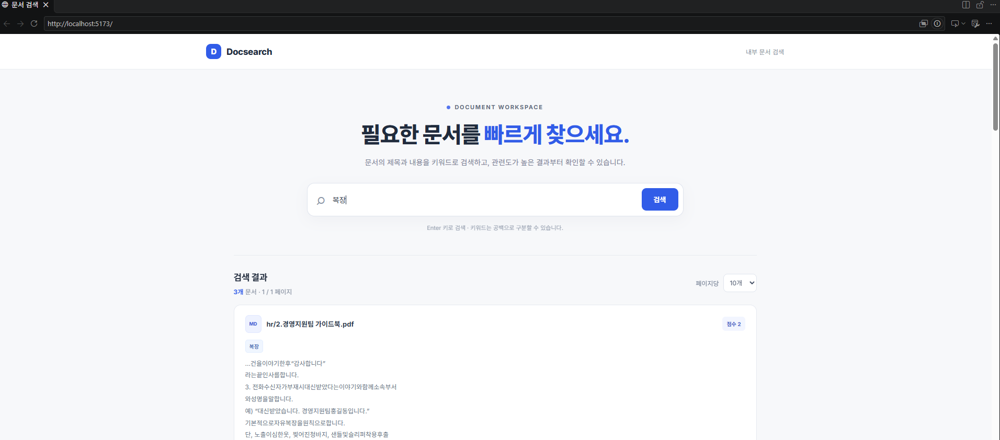

# MCP Document Search

docs/ 디렉터리에 업로드된 문서를 탐색하고 검색할 수 있는 MCP 서버입니다.



주요 기능
- 문서 목록 조회
- 검색어 기반의 문서 검색 및 페이지네이션 지원
- 지원 파일 형식: .md, .txt, .pdf, .ppt, .pptx, .docx, .xlsx


## Requirements

Python 3.10+, Node.js 18+

## Run backend

```bash
python -m venv .venv
source .venv\Scripts\activate
python -m pip install -e '.[test]'
```

Run the MCP server :

```bash
python -m server.main
```

Run the HTTP adapter :

```bash
uvicorn server.http_api:app --host 127.0.0.1 --port 8000
```

## Run web UI

```bash
cd web
npm install
npm run dev
```

`http://localhost:5173`
